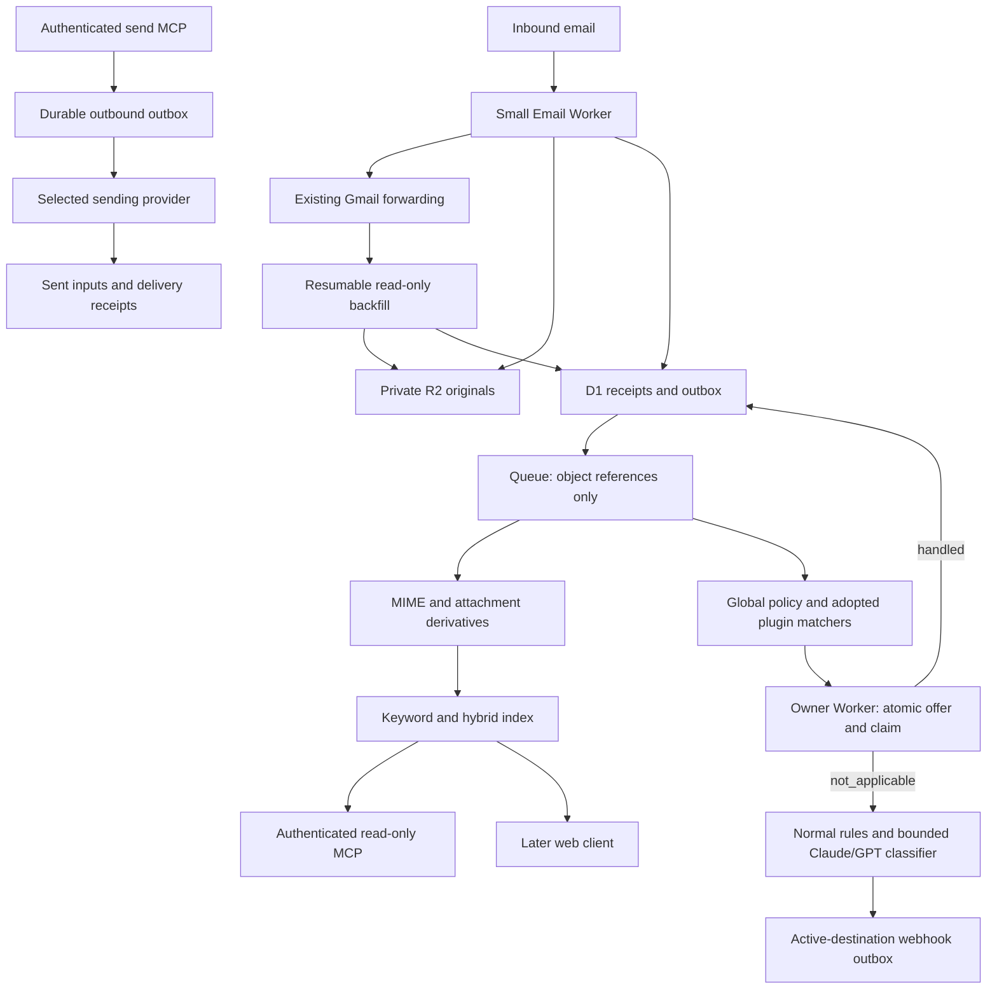

# Architecture proposal

Status: proposed, 2026-11-07. No application runtime has been implemented.

## Data flow

Import events may be normalized and indexed but never produce historical action
notifications. The two phase-2 tracks share stable IDs and provenance, not a
single long synchronous workflow.

## Capture and recovery

Keep the email handler small: archive bytes, record receipt, preserve forwarding.
Do not run model inference, extraction or decryption on the SMTP path. Forwarding
and R2/D1/Queue writes are separate operations, not one transaction. The initial
policy prioritizes existing Gmail delivery when archival fails, with alerts and
Gmail gap reconciliation. Verify forwarding and archival outcomes independently;
do not assume an uncaught exception guarantees SMTP redelivery.

Store original MIME without rewriting it, including encrypted attachments. R2
stream uploads require known length; test `rawSize` with `FixedLengthStream` or
bounded buffering. Workers memory limits apply to parser object graphs, base64
decoding and decompression together. Queue messages carry object IDs, not mail
bodies. See the [email handler](https://developers.cloudflare.com/email-service/api/route-emails/email-handler/),
[R2 binding](https://developers.cloudflare.com/r2/api/workers/workers-api-reference/),
[Workers limits](https://developers.cloudflare.com/workers/platform/limits/) and
[Queue limits](https://developers.cloudflare.com/queues/platform/limits/).

Use an ingress receipt ID or Gmail account/message ID as source identity, raw
hashes for byte identity, and a separate logical-message link. Message-ID alone
is not trustworthy or unique. Gmail copies may differ from ingress bytes because
forwarding adds headers. Preserve both provenance and the relationship rather
than assuming equal hashes. Derivatives retain parent IDs, hashes, extraction
version, page/part locations and success/unsupported/error states.

D1 holds structured metadata, processing status, checkpoints and an outbox.
Queues provide independent retryable work. A small scheduled reconciler can
repair R2 objects lacking metadata and outbox rows not yet enqueued. Consumers
must be idempotent. Define object-key conventions that support recovery without
putting subject lines or addresses in keys. Add a Durable Object only for a
demonstrated coordination need, such as active-account fencing or a serialized
claim that cannot be handled transactionally by its existing owner. No DO per
message by default. Workflows are optional for multi-step durable jobs later.

## Gmail import and search

Use `gmail.readonly`, paginated message listing and `messages.get(format=RAW)`;
RAW includes attachment MIME. Preserve Gmail labels, thread IDs and internalDate.
Define spam/trash inclusion explicitly. Commit checkpoints only after durable
storage; use history sync for reconciliation and restart a full scan when the
history cursor expires. [Gmail messages](https://developers.google.com/workspace/gmail/api/reference/rest/v1/users.messages),
[sync guide](https://developers.google.com/workspace/gmail/api/guides/sync).

Index normalized text and supported attachment derivatives, never assume `.eml`
or encrypted bytes are searchable. Start with metadata filters plus keyword and
vector/hybrid retrieval. Evaluate managed AI Search before writing a full custom
indexer; keep D1 metadata authoritative and evaluate D1 FTS5 plus Vectorize if
filtering, freshness or ranking needs exceed the managed path. Japanese keyword
search needs explicit tokenizer evaluation: AI Search's trigram has a short-term
limitation below three characters. [R2 data source](https://developers.cloudflare.com/ai-search/configuration/data-source/r2/),
[keyword indexing](https://developers.cloudflare.com/ai-search/configuration/indexing/keyword-search/).

Expose read-only MCP search, message/thread access and attachment access with
authentication and per-object authorization. Return citations to actual MIME
parts/pages and extraction quality; retrieval failure or pending decryption must
be visible. A custom authenticated Worker can call the private search binding;
do not expose a managed public search endpoint for private mail by default.
Apply access filters before evidence reaches the model.

The requested paper, [Retriever-Free Retrieval: Navigating Documents with Decision Models](https://arxiv.org/html/2610.35868),
introduces DecisionRAG: joint candidate decisions traverse a topic/document/passage
hierarchy. It still needs hierarchy construction and has pruning-recall risks.
Reported results use non-generative decision models, including Jev; replacing
them with Claude/GPT calls does not establish the same latency or cost. Treat it
as an experiment alongside a hybrid baseline on bilingual mail, exact identifiers,
attachments and cross-message questions, not as a settled production dependency.

## Rules, plugins and classification

Use [owner-maintained plugins](plugins.md). Global policy controls access and
delivery, adopted CEL predicates choose candidates, and owner Workers decide
whether they can actually handle them. Owner rules stay upstream. Only explicit
`not_applicable` falls through; ambiguous outcomes are reconciled.

Ordinary rules decide known cases first. The classifier receives bounded excerpts
only when needed and returns a schema-validated category, evidence and proposed
action. Claude/GPT are provider choices; the model cannot choose a URL or grant
capabilities. Low-confidence/error outcomes remain explicit. Webhook destination
IDs map to configured allowed endpoints, with signing, idempotency and retries
outside the model. Dispatch only to the currently active destination, using a
generation/lease fence and rechecking ownership at dispatch time.

Treat envelope/header identity as distinct from authenticated sender identity.
Only trust authentication results at the verified inbound boundary; an address
allowlist or sender-authored header alone is insufficient. Email text and retrieved
attachments are untrusted data, including when asking a model for classification.
Record closed outcome codes and IDs in logs, not bodies, codes, passwords or tokens.

## Outbound MCP

MCP also gains a separate [outbound send capability](outbound-mcp.md), with
optional drafts/previews, explicit sender authorization and a durable outbox.
It is independent of incoming classification and specialist plugin ownership.
Submission inputs and delivery receipts join the archive with their own
provenance; receiving mail never implicitly authorizes sending a reply.

## Password-protected attachments

Keep encrypted originals, then save verified decrypted files as distinct private
derivatives. Start with related-message search and deterministic candidate
extraction; a bounded LLM can suggest candidates with source references. Test
those candidates locally and accept only successful decryption and integrity
validation. A later password message can requeue pending attachments.

Use narrow authorized search windows, bounded attempts and strict file-count,
expanded-size, path, nesting, CPU and memory limits. No brute-force keyspace
search. Candidate secrets do not enter logs or general search indexes. The
decrypted derivative may reveal more than the original; apply explicit access
and retention rules. Supported ZIP/PDF cases must pass actual Workers tests;
unsupported formats stay archived and pending rather than silently introducing
a container dependency.
